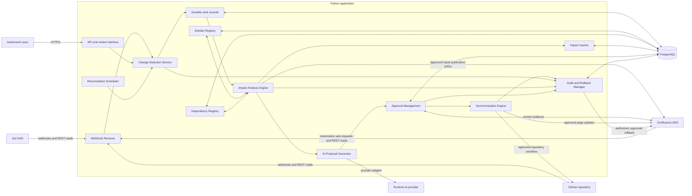
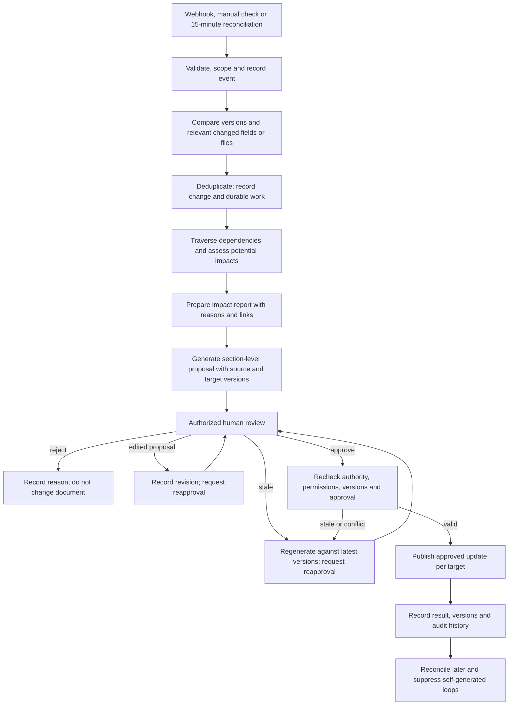
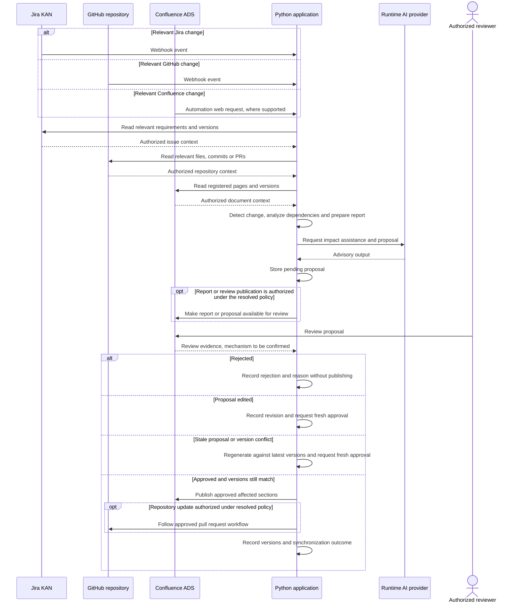
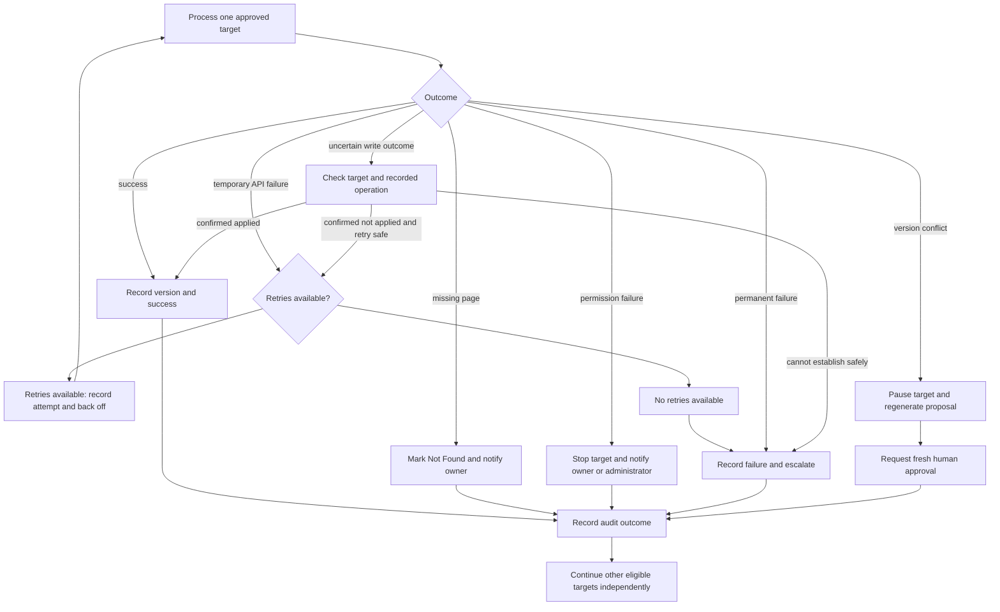
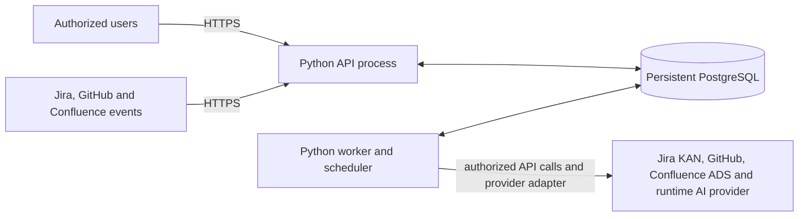

# Architecture: Agentic SDLC - Automated Documentation Sync

**Status:** Proposed - Pending Design Review  
**Source:** [Approved requirements](requirements.md), [Jira KAN-1](https://demo-capstone-github-copilot.atlassian.net/browse/KAN-1)

## 1. Purpose and scope

This proposal describes a high-level architecture for detecting changes in
registered artefacts, analyzing their impact, generating reviewable proposals
and synchronizing approved changes. It is based on the approved requirements;
recommendations in this document are not additional approved requirements.

The initial integration boundary is Jira project KAN, one capstone GitHub
repository and Confluence space ADS. The GitHub repository identifier and
tracked branches must be configured once confirmed. No unrelated projects,
repositories or spaces are included.

Jira is authoritative for business requirements, user stories and acceptance
criteria. GitHub holds mandatory committed Markdown deliverables; ADS is the
central documentation workspace. Controlled bidirectional synchronization
requires an authoritative source per artefact type. Where authority is not
yet defined, the system must not guess or silently overwrite either side.

## 2. Architecture overview and recommended system architecture

Use a **Python modular monolith**: one application codebase with explicit
component interfaces, deployed as an API process and a background worker
process. The worker also runs the reconciliation scheduler. Both processes
use a shared PostgreSQL database for durable state and work coordination.
They communicate through database-backed work records, not an external
message broker. External systems are accessed through separate adapters.

This keeps deployment small while isolating responsibilities and allowing
the webhook receiver to acknowledge requests without waiting for analysis,
AI generation, human review or publication.

### Component architecture diagram

This view shows the proposed Python application's logical components, its
database, external integrations and human actors. Arrows trace events and
work from the receiver through analysis, review, synchronization and audit;
two-way arrows denote data exchange. The external-source arrows summarize
both inbound events and application-initiated REST reads: REST reads are
requests from the application to the external system, with responses in the
opposite direction. The view matters because it exposes the approval boundary
and shared durable state without implying separate services for each component.

<details>
<summary>Original component diagram source (preserved; superseded)</summary>



</details>

The original source above is historical: its combined event/REST arrow labels
do not accurately distinguish request direction. The corrected grouped view
below retains the original components and relationships while showing
application-initiated REST requests and their responses separately from events.
Repeated
labels in different groups represent the same logical component or external
system, not additional services, databases or integrations. The groups
separate processing, external communication, storage and auditing to make
individual connections easier to follow.

<details>
<summary>Previous grouped component diagram source (preserved; superseded)</summary>

```text
flowchart TB
    subgraph Flow["Python application: processing and approval"]
        direction TB
        Receiver["Webhook Receiver"] --> Change["Change Detection Service"]
        API["API and review interface"] --> Change
        Scheduler["Reconciliation Scheduler"] --> Change
        Change --> Jobs["Durable work records"]
        Jobs --> Impact["Impact Analysis Engine"]
        Registry["Artefact Registry"] <--> Impact
        Deps["Dependency Registry"] <--> Impact
        Impact --> Reports["Impact reports"]
        Impact --> Generator["AI Proposal Generator"]
        Generator --> Approval["Approval Management"]
        Approval --> Sync["Synchronization Engine"]
    end

    subgraph Inbound["External inputs"]
        direction LR
        JiraIn["Jira KAN"] -->|webhooks and REST reads| ReceiverIn["Webhook Receiver"]
        GitHubIn["GitHub repository"] -->|webhooks and REST reads| ReceiverIn
        ConfIn["Confluence ADS"] -->|Automation web requests and REST reads| ReceiverIn
        Users["Authorized users"] -->|HTTPS| APIIn["API and review interface"]
    end

    subgraph Outbound["External interactions"]
        direction LR
        GeneratorOut["AI Proposal Generator"] -->|provider adapter| AI["Runtime AI provider"]
        ImpactOut["Impact Analysis Engine"] -->|approved report publication policy| ConfReport["Confluence ADS"]
        ApprovalOut["Approval Management"] <-->|review evidence| ConfReview["Confluence ADS"]
        SyncOut["Synchronization Engine"] -->|approved page updates| ConfUpdate["Confluence ADS"]
        SyncRepo["Synchronization Engine"] -->|approved repository workflow| GitHubOut["GitHub repository"]
        AuditOut["Audit and Rollback Manager"] -->|authorized, approved rollback| ConfRollback["Confluence ADS"]
    end

    subgraph State["Shared durable state"]
        direction LR
        JobsDB["Durable work records"] <--> DB[("PostgreSQL")]
        RegistryDB["Artefact Registry"] <--> DB
        DepsDB["Dependency Registry"] <--> DB
        ReportsDB["Impact reports"] <--> DB
        ApprovalDB["Approval Management"] <--> DB
        AuditDB["Audit and Rollback Manager"] <--> DB
    end

    subgraph AuditFlow["Audit connections"]
        direction LR
        ChangeAudit["Change Detection Service"] --> Audit["Audit and Rollback Manager"]
        ImpactAudit["Impact Analysis Engine"] --> Audit
        ApprovalAudit["Approval Management"] --> Audit
        SyncAudit["Synchronization Engine"] --> Audit
    end

    Flow ~~~ Inbound
    Inbound ~~~ Outbound
    Outbound ~~~ State
    State ~~~ AuditFlow
```

</details>




```mermaid
flowchart TB
    subgraph Flow["Python application: processing and approval"]
        direction TB
        Receiver["Webhook Receiver"] --> Change["Change Detection Service"]
        API["API and review interface"] --> Change
        Scheduler["Reconciliation Scheduler"] --> Change
        Change --> Jobs["Durable work records"]
        Jobs --> Impact["Impact Analysis Engine"]
        Registry["Artefact Registry"] <--> Impact
        Deps["Dependency Registry"] <--> Impact
        Impact --> Reports["Impact reports"]
        Impact --> Generator["AI Proposal Generator"]
        Generator --> Approval["Approval Management"]
        Approval --> Sync["Synchronization Engine"]
    end

    subgraph Inbound["External inputs"]
        direction LR
        JiraIn["Jira KAN"] -->|webhooks| ReceiverIn["Webhook Receiver"]
        GitHubIn["GitHub repository"] -->|webhooks| ReceiverIn
        ConfIn["Confluence ADS"] -->|Automation web requests| ReceiverIn
        Users["Authorized users"] -->|HTTPS| APIIn["API and review interface"]
    end

    subgraph Reads["Application-initiated REST reads"]
        direction LR
        Adapter["Integration adapters"] -->|REST requests| Sources["Jira KAN, GitHub and Confluence ADS"]
        Sources -->|responses| Adapter
    end

    subgraph Outbound["External interactions"]
        direction LR
        GeneratorOut["AI Proposal Generator"] -->|provider adapter| AI["Runtime AI provider"]
        ImpactOut["Impact Analysis Engine"] -->|approved report publication policy| ConfReport["Confluence ADS"]
        ApprovalOut["Approval Management"] <-->|review evidence| ConfReview["Confluence ADS"]
        SyncOut["Synchronization Engine"] -->|approved page updates| ConfUpdate["Confluence ADS"]
        SyncRepo["Synchronization Engine"] -->|approved repository workflow| GitHubOut["GitHub repository"]
        AuditOut["Audit and Rollback Manager"] -->|authorized, approved rollback| ConfRollback["Confluence ADS"]
    end

    subgraph State["Shared durable state"]
        direction LR
        JobsDB["Durable work records"] <--> DB[("PostgreSQL")]
        RegistryDB["Artefact Registry"] <--> DB
        DepsDB["Dependency Registry"] <--> DB
        ReportsDB["Impact reports"] <--> DB
        ApprovalDB["Approval Management"] <--> DB
        AuditDB["Audit and Rollback Manager"] <--> DB
    end

    subgraph AuditFlow["Audit connections"]
        direction LR
        ChangeAudit["Change Detection Service"] --> Audit["Audit and Rollback Manager"]
        ImpactAudit["Impact Analysis Engine"] --> Audit
        ApprovalAudit["Approval Management"] --> Audit
        SyncAudit["Synchronization Engine"] --> Audit
    end

    Flow ~~~ Inbound
    Inbound ~~~ Reads
    Reads ~~~ Outbound
    Outbound ~~~ State
    State ~~~ AuditFlow
```

Arrows show logical communication, not independent deployable services. All
external writes, including report and review artefact creation, remain subject
to the approved cross-system authorization policy; the unresolved
report-publication question in section 12 must be settled before those writes
are automated.

## 3. Technology recommendations

| Area | Recommendation | Reason |
| --- | --- | --- |
| Application and tests | Python for all application logic, backend services, synchronization and automated tests | Meets the language constraint and supports the integrations in one ecosystem. No Node.js application runtime is introduced. |
| HTTP API | FastAPI with Pydantic validation and an ASGI server such as Uvicorn | Supports typed request validation, webhook endpoints and an authenticated review interface without a separate frontend runtime. |
| External HTTP | HTTPX through Jira, GitHub, Confluence and AI provider adapters | Provides a consistent Python HTTP client, timeouts and testable integration boundaries. |
| Database | PostgreSQL, accessed through SQLAlchemy and managed migrations such as Alembic | Provides persistent relational records, transactions, constraints and row-level locking for registries, approvals, audit and durable jobs without a separate queue. |
| Scheduling | A Python scheduler such as APScheduler in the worker, with database-backed coordination | Supports configurable periodic reconciliation while avoiding an additional scheduler service. Execution ownership must be coordinated if more than one worker is deployed. |
| Automated verification | pytest and Python HTTP mocks or fakes | Supports unit and integration testing of workflow, adapters, error paths and approval boundaries without external calls in unit tests. |
| Packaging and deployment | Python containers, or equivalent managed Python processes, with a persistent PostgreSQL service | Provides reproducible deployment while keeping API and worker in the same codebase. Containerization is a deployment option, not a Node.js dependency. |
| Operations | Structured Python logging, health checks and the chosen hosting platform's monitoring | Provides basic observability without assuming a separate monitoring stack. Logs must not expose secrets or sensitive personal information. |

These are recommendations for review. Exact versions, hosting provider, OAuth
scopes, runtime AI provider and retention periods remain to be decided.

## 4. Component responsibilities and communication

| Component | Responsibility and communication |
| --- | --- |
| **Artefact Registry** | Stores registered sources and artefacts, their identifiers, type, location, owner where applicable, versions, related documents, last detected change and last successful synchronization status. Supports authorized manual registration and assisted API discovery. Other components query it through an internal repository interface. |
| **Dependency Registry** | Stores directed source-to-dependent relationships, relationship types and metadata. Authorized members review, approve and modify suggested dependencies. Traversal supports direct and transitive impacts, detects cycles and records changes for audit. |
| **Webhook Receiver** | Exposes HTTPS endpoints for configured sources. Authenticates and validates requests, limits processing to configured scope and durably records accepted events before acknowledging them. It hands work to the Change Detection Service; it does not publish documents. |
| **Change Detection Service** | Normalizes accepted events and manual or reconciliation discoveries; compares source versions and relevant fields or files; filters irrelevant activity; deduplicates changes and prevents self-triggered loops. It creates durable impact-analysis work and records outcomes. |
| **Reconciliation Scheduler** | Starts a comparison of registered artefacts with known versions every 15 minutes by default, configurable. It submits missed changes to the same detection path. An authorized manual check uses that path too. |
| **Impact Analysis Engine** | Traverses approved dependency records, including transitive paths, combines changed-field or file information with requirement-to-design-to-code-to-test traceability, and considers AI-suggested additional impacts. It records reasons, direct or indirect paths, severity, confidence, recommended action and synchronization status for the report. Unknown severity or confidence rules remain unresolved rather than silently invented. |
| **AI Documentation Proposal Generator** | Uses a provider adapter and authorized, relevant context to produce structured, reviewable before-and-after proposals with source references and uncertainties. It cannot approve or publish changes. |
| **Approval Management** | Associates each proposal with the document owner or designated reviewer, a specific proposed change and relevant source and target versions. It records authenticated approval, rejection and reason, invalidates approval after edits or staleness, and exposes review information in ADS with GitHub pull requests for repository changes. |
| **Synchronization Engine** | Processes each approved target independently, rechecks authorization, approval and versions, and applies approved changes through the relevant adapter. It preserves unrelated content and formatting, detects conflicts and records each outcome. It does not publish a rejected, stale or unapproved update. |
| **Audit and Rollback Manager** | Persists required change, proposal, decision, version, failure, retry and privileged-action records; coordinates restoration of a previous approved version after authorized document-owner approval; and records the rollback. |
| **Integration adapters** | Encapsulate source-specific authentication, API calls, pagination, version checks and error classification. They return normalized results to the application and do not decide approval or authority policy. |
| **API and review interface** | Authenticates users, enforces RBAC, offers manual registration, discovery and synchronization controls, and presents status and review links. The precise ADS review and GitHub approval integration is unresolved. |

### Registry and dependency suggestion contracts

The artefact registry records each entry's unique internal ID, name, type,
source system and source-system ID, URL or repository path, current version
or last-modified timestamp, related document IDs and dependencies, last
detected change timestamp, and last successful synchronization status
(FR-004). Each document needs an identifiable owner. If ownership cannot be
established, record the gap, surface it for resolution and do not authorize
an owner-dependent action. The authoritative identity source remains open.

The Impact Analysis Engine is the proposed owner of artefact analysis for
dependency suggestions. It records each proposed source, dependent,
relationship type, supporting evidence and uncertainty as a pending suggestion
in the Dependency Registry. Authorized members review, approve or modify
suggestions; changes are audited. Only approved dependencies participate in
recorded-dependency traversal; AI-suggested additional impacts remain
advisory. The precise suggestion method and reviewer identity source remain
unresolved.

### Impact report contract

Before any proposed document update is published, generate and validate a
report containing every FR-017 field:

| Report field | Proposed source |
| --- | --- |
| Change ID, timestamp, source artefact, source identifier and change summary | Recorded normalized change and Artefact Registry |
| Affected document IDs, titles and links | Artefact Registry and authorized source reads |
| Reason for impact, direct or indirect dependency path and recommended action | Impact Analysis Engine and approved Dependency Registry |
| High, Medium or Low severity and explanation, confidence level and synchronization status | Impact Analysis Engine and recorded target status |
| Relevant Jira issue, GitHub commit or pull request link | Authorized source event and integration metadata |

Store reports under the dedicated ADS Impact Analysis section when authorized
under the still-unresolved cross-system publication policy. Rule-based
severity must include an explanation; the exact classification rules and
confidence method require confirmation. Do not invent numerical thresholds.
If required report data or classification is unavailable, surface the gap
instead of fabricating a value.

## 5. Integrations and source boundaries

### 5.1 Jira KAN

Use Jira Cloud REST APIs to discover and read permitted KAN issues, relevant
fields, descriptions, acceptance criteria, issue links and versions or
timestamps. Jira webhooks notify the receiver of relevant creates, updates and
deletes. Fetch and compare the relevant state to determine what changed; do
not assume every issue update changes requirements.

Treat Jira requirements and acceptance criteria as authoritative. Other issue
types, status and metadata are in scope when relevant. Jira write behavior for
other artefact types must not be assumed from this authority rule.

### 5.2 GitHub

Use GitHub APIs to read permitted repository files, commits, pull requests and
relevant change details. GitHub webhooks notify the receiver of pushes and
pull request events; process only configured branches and registered relevant
paths. Track renames and deletions. Repository changes use GitHub pull
requests and require the approved human workflow.

The precise authoritative-source mapping and the relationship between
cross-system approval, pull request creation and pull request approval remain
open. Do not write to a repository or treat an unmerged change as
authoritative until the applicable policy is established.

### 5.3 Confluence ADS

Use Confluence Cloud APIs to discover and read registered ADS pages, their
content and versions, and to update approved affected sections while
preserving supported rich content and page history. Confluence Cloud
Automation is the proposed event source for publication, edits, deletion,
moves, archiving and restoration; where supported, Send Web Request notifies
the Python receiver. Confirm available triggers, authentication and payload
capabilities for the actual site. Reconciliation is the recovery path for
missed events, not a substitute for an unconfigured primary mechanism.

Impact reports belong under a dedicated ADS Impact Analysis section. Review
also takes place in ADS. Their precise creation and approval mechanics are
unresolved; no automatic report or review-page write should bypass the
cross-system approval rule. The mechanism for capturing and validating
Confluence review decisions must be confirmed.

### Version-guarded section updates

The proposed Confluence adapter reads the current supported rich-content
representation, page version and the affected section. It verifies the
proposal, authorized reviewer, source and target versions, and the intended
section against the approved evidence immediately before publication.
Use a supported conditional or version-guarded write, not a read alone, to
protect against concurrent edits. Modify only approved affected sections,
preserving unrelated content, tables, links, embeds and page history. Validate
the resulting version, intended change and preservation after the write.
On a mismatch or ambiguous section identity, pause the target and surface the
conflict; regenerate against current versions and obtain fresh approval.

The exact site-supported representation, section identification and
conditional-write mechanism require integration validation. If safe
preservation or an atomic version guard cannot be established, do not
publish. A full logical page replacement requires explicit approval under
FR-027; full-body API transport alone does not determine the logical scope.
ADS report and review publication and approval capture remain subject to the
unresolved decisions in section 12.

## 6. End-to-end data flow

### End-to-end data-flow diagram

This view follows a change from a webhook, manual check or reconciliation
through impact analysis, proposal, human review, publication and audit.
Arrows show the progression; the rejection branch stops publication, while
edits, staleness and conflicts return to review. It matters because every
path to a document update passes the approval and version-check boundary.

<details>
<summary>Previous data-flow diagram source (preserved; superseded)</summary>

```text
flowchart TD
    A["Webhook, manual check or 15-minute reconciliation"] --> B["Validate, scope and record event"]
    B --> C["Compare versions and relevant changed fields or files"]
    C --> D["Deduplicate; record change and durable work"]
    D --> E["Traverse dependencies and assess potential impacts"]
    E --> F["Prepare impact report with reasons and links"]
    F --> G["Generate section-level proposal with source and target versions"]
    G --> H["Authorized human review"]
    H -->|reject| I["Record reason; do not change document"]
    H -->|edit or stale| J["Regenerate or revise; request reapproval"]
    J --> H
    H -->|approve| K["Recheck authority, permissions, versions and approval"]
    K -->|conflict| J
    K -->|valid| L["Publish approved update per target"]
    L --> M["Record result, versions and audit history"]
    M --> N["Reconcile later and suppress self-generated loops"]
```

</details>

In the corrected view, proposal edits and stale or conflicting versions
follow distinct paths. Stale or conflicting proposals must be regenerated
against the latest versions and reapproved; edits also require reapproval.




1. A validated event, authorized manual check or reconciliation identifies a
   change. The receiver persists accepted event identity before acknowledgment;
   the worker retrieves the relevant permitted source state.
2. The change detector filters non-relevant activity, compares versions and
   deduplicates the work. The registries provide the artefact, owner and
   approved dependency information.
3. The impact engine traverses direct and transitive relationships with cycle
   detection, adds explainable potential impacts and prepares the required
   report. Report creation in ADS follows the policy to be resolved in
   section 12. The report must be generated before proposed document updates
   are published.
4. The proposal generator uses authorized relevant context and the current
   target version to produce a structured comparison. It stores the proposal
   as pending, not as an edit to the source document.
5. An authorized owner or designated reviewer reviews each proposal in the
   agreed ADS workflow; repository changes use a GitHub pull request. Approval
   is tied to the exact proposal and versions. Rejection records the reason;
   edits require fresh approval. Staleness requires regeneration using the
   latest versions and fresh approval.
6. Before publishing, the synchronization engine checks authority, the
   reviewer decision, source and target versions and permissions. It updates
   only approved sections of registered ADS pages, or follows the approved
   repository workflow. A conflict pauses the affected target and returns it
   for regeneration and reapproval.
7. The audit manager records the source, proposal, decision, before-and-after
   content, versions, outcome and errors. Other eligible targets continue if
   one fails. Reconciliation and loop suppression prevent missed or repeated
   work from becoming silent inconsistencies.

Approval evidence must identify the target, exact proposal and source/target
versions, the authenticated reviewer, decision and any rejection reason.
Recheck the reviewer's authority for that target before publication; an
edited proposal invalidates its prior approval. A stale proposal or version
conflict requires regeneration using the latest versions and fresh approval.
Owner-approved rollback must likewise bind approval to the intended previous
version and current target state. If identity, authorization or evidence
cannot be verified, stop the affected write. How ADS decisions, GitHub pull
request approvals and rollback approvals are captured and linked remains
unresolved; a PR event alone is not proof of document-specific approval.

### Jira, GitHub and Confluence interaction sequence

This illustrative sequence shows the three external systems, the Python
application, the provider-independent AI interface and an authorized reviewer.
Messages run from sender to receiver in time order. Events initiate processing;
application-initiated reads provide context; review evidence and version checks
precede any approved update. The optional report and review publication step
is conditional on the unresolved authorization policy, and the precise review
mechanism is not assumed. This view matters because it distinguishes source
events, contextual reads and controlled writes across system boundaries.

<details>
<summary>Previous interaction sequence source (preserved; superseded)</summary>

```text
sequenceDiagram
    participant Jira as Jira KAN
    participant GitHub as GitHub repository
    participant ADS as Confluence ADS
    participant App as Python application
    participant AI as Runtime AI provider
    actor Reviewer as Authorized reviewer

    alt Relevant Jira change
        Jira->>App: Webhook event
    else Relevant GitHub change
        GitHub->>App: Webhook event
    else Relevant Confluence change
        ADS->>App: Automation web request, where supported
    end
    App->>Jira: Read relevant requirements and versions
    Jira-->>App: Authorized issue context
    App->>GitHub: Read relevant files, commits or PRs
    GitHub-->>App: Authorized repository context
    App->>ADS: Read registered pages and versions
    ADS-->>App: Authorized document context
    App->>App: Detect change, analyze dependencies and prepare report
    App->>AI: Request impact assistance and proposal
    AI-->>App: Advisory output
    App->>App: Store pending proposal
    opt Report or review publication is authorized under the resolved policy
        App->>ADS: Make report or proposal available for review
    end
    Reviewer->>ADS: Review proposal
    ADS-->>App: Review evidence, mechanism to be confirmed
    alt Rejected, edited or stale
        App->>App: Record decision or regenerate and request reapproval
    else Approved and versions still match
        App->>ADS: Publish approved affected sections
        opt Repository update authorized under resolved policy
            App->>GitHub: Follow approved pull request workflow
        end
        App->>App: Record versions and synchronization outcome
    end
```

</details>

The corrected sequence separates rejection, edited proposals, and stale or
conflicting versions. The latter require regeneration from the latest
versions and fresh approval.




## 7. Data storage and state

PostgreSQL is the recommended persistent store for:

- Registered systems and artefacts, source identifiers, paths or URLs, owner,
  versions, change timestamps and last successful synchronization status.
- Directed dependency edges, relationship metadata, review status and
  dependency-change history.
- Received event identities, normalized changes, durable jobs, leases,
  attempts and reconciliation checkpoints.
- Impact reports and their publication references, proposals with before-and-
  after content and source references, review decisions and target versions.
- Synchronization outcomes, errors, prior and published versions, rollback
  approvals and actions, and audit records.

Use database uniqueness constraints for stable event and job identities,
transactions for local state transitions, and row locks or leases to coordinate
workers. Store only authorized, relevant content; protect persisted proposal
and audit data as well as credentials. Retention is configurable according to
organizational policy. Back up the database and preserve Confluence page
history; backup and restore operational details require confirmation.

The proposed durable handoff records accepted event identity and work creation
in one local transaction, or uses a recoverable persisted event state that
will reliably create work before the event is considered complete. Enforce
stable event and per-target operation identities with uniqueness constraints.
Claim work with a lease; on expiry, recover work only after checking the prior
operation's state. Record each attempt and transition. A database transaction
cannot atomically commit an external write: after a crash or timeout, verify
the target and recorded operation before retrying; stop and escalate if the
outcome cannot be established safely.

Audit records retain the required source and document versions, before-and-
after content, proposal and review decisions, dependency changes, privileged
actions, retries, failures and outcomes. Restrict access to sensitive audit
material and configure retention according to the policy to be confirmed;
do not expose secrets or sensitive personal information in logs, reports or
generated documents. Rollback evidence includes the previous approved version,
authorized document-owner approval, acting user and outcome. Check current
versions and permissions before restoration, preserve history, and surface
conflicts rather than overwrite newer changes. The approval capture mechanism
and exact retention periods remain open.

Confluence remains the workspace for reports and documentation; GitHub
remains the repository for committed deliverables. Database records support
coordination and audit and do not by themselves change source authority.
No separate object store, graph database or message broker is proposed
initially.

## 8. Security and access

- Use OAuth-based authentication for external integrations and authenticated
  application users. An authorized service identity publishes approved
  Confluence changes. Select actual OAuth flows, product capabilities and
  least-privilege scopes during design; do not assume permissions from access
  to a space or repository.
- Enforce RBAC at the application boundary and again at privileged workflow
  transitions: administrators manage integrations and permissions; project
  members view registry and reports; document owners or designated reviewers
  approve or reject; the authorized service account publishes. Verify the
  reviewer is authorized for the target document.
- Use HTTPS for incoming and outgoing traffic. Validate GitHub webhook
  signatures and use supported authentication and verification for Jira
  webhooks and Confluence Automation requests. Confirm each sender's actual
  capabilities, including replay protection; reject unauthenticated or
  unverifiable requests. Do not assume all senders use GitHub's signature
  scheme.
- Keep credentials in environment variables or an approved secret manager;
  limit access and never include secrets in artefact discovery, AI context,
  logs, reports or generated documents. Exclude environment files and
  sensitive configuration values. Protect audit data and reviewer identities
  against unauthorized disclosure while recording required actions.
- Limit AI context to authorized, relevant project information. Treat source
  content and model responses as untrusted; validate structured output and
  never let model text authorize an action or override human approval.

Exclude secrets and sensitive information from AI inputs and generated
outputs, even when the requesting user can access them. Define and verify
screening and provider data-handling controls before enabling AI integration;
fail and report when safe input or output cannot be established. Exact
classification and provider controls require confirmation. Validate GitHub
signatures and verify the actual authentication, replay protections and
event-trigger coverage supported by Jira and Confluence for this site; reject
unverifiable events. OAuth flows, scopes and service permissions remain
unconfirmed and must be least-privilege.

## 9. Reliability and failure handling

- Persist accepted event and work records before acknowledgment; use stable
  event identities, unique constraints and idempotent handlers to avoid
  duplicate work. Deduplicate reconciliation findings against already
  processed source versions as well as webhook deliveries.
- Handle simultaneous events with transactional state changes and per-target
  coordination. Before publication compare the approved source and target
  versions with current versions; use the external system's supported
  version or conditional-write mechanism. A mismatch pauses that target and
  requires regeneration and reapproval.
- Recognize system-originated writes by recorded operation and version
  information to avoid loops. Do not suppress later independent human edits.
- Retry transient API failures with configurable exponential backoff and at
  most three retries. Record each attempt and final outcome. Permanent
  failures are recorded and escalated to the responsible owner.
- For an ambiguous timeout after an external write, check the target and
  recorded operation before retrying; if the outcome cannot be established
  safely, stop and surface it rather than risk a duplicate or overwrite.
  Database transactions alone cannot guarantee exactly-once external writes.
- Missing pages are marked Not Found and the document owner is notified; do
  not create replacements automatically. Permission failures stop the
  affected update and notify the owner or administrator. Process other
  eligible pages independently.
- Reconcile registered artefacts every 15 minutes by default, with a
  configurable interval; record checkpoints and failures. Manual checks use
  the same safe, idempotent processing path. Availability is best effort;
  quantitative targets remain deferred.

Reconciliation must track durable per-source checkpoints and process all
pages of available results before advancing a completed checkpoint. Compare
registered identities, versions, paths and applicable issue links; use
available source history or deletion records to identify missed changes,
renames and deletions. A current-state comparison cannot guarantee recovery of
intermediate changes that are no longer observable. Record and escalate
unrecoverable history or incomplete scans; do not claim those events were
recovered. Confirm actual history, pagination and lifecycle-event coverage
with each integration.

Classify errors using the source's supported semantics: distinguish
confirmed missing documents, confirmed permission failures, transient errors,
permanent errors and ambiguous outcomes. A 404 alone may not establish
deletion when access is concealed. Stop and surface ambiguous cases, and never
create a replacement automatically. Notify the document owner for confirmed
missing pages, the owner or administrator for permission failures, and the
responsible owner for permanent failures. Record notification delivery
failures and escalate when an owner is unknown. The notification and
escalation mechanisms require confirmation. Allow at most three retries
after the initial attempt, with configurable exponential backoff; record
each attempt and outcome.

### Failure handling and recovery flow

This view shows the synchronization engine's per-target failure paths and the
audit record. Arrows separate missing pages, permission failures, transient
API failures, uncertain write outcomes and version conflicts. Safe retries
return to the affected target; conflicts require a revised proposal and fresh
approval. Other eligible targets continue independently. This view matters
because recovery must not turn a failure into an unapproved or duplicate write.




## 10. AI integration and development tools

The runtime application calls a **provider-independent AI interface** for
potential impact suggestions and documentation proposals. A provider adapter
maps authorized, minimized context to the selected provider and validates
the response into the application's structured proposal and impact formats.
The runtime provider, data-handling terms and detailed confidence method remain
to be selected. Rule-based severity is High, Medium or Low with an
explanation; exact classification rules are unresolved and numerical scoring
is not initially required.

AI output is advisory. Dependency records, source authority, access checks,
version checks and human approval remain application-controlled; the model
cannot publish or approve. If AI generation fails or produces unusable output,
record and surface the failure rather than publish an unreviewed substitute.

GitHub Copilot is the development assistant used during the SDLC. Atlassian
Rovo MCP is a development-workflow tool for interacting with Atlassian
resources. Neither is assumed to be the deployed application's runtime AI
provider or integration transport.

## 11. Deployment and operations

Deploy one Python API instance and one Python worker/scheduler instance from
the same application codebase, alongside a persistent PostgreSQL service.
Expose only the HTTPS API endpoints needed for authenticated users and
webhooks. Provide outbound access only to the configured Jira, GitHub,
Confluence and selected AI provider endpoints.

Configure the project and space boundaries, repository and tracked branches,
credentials, reconciliation interval and retry backoff through protected
configuration. Use a persistent database volume or managed database with
backup and recovery. Health checks and operational alerts should surface
failed jobs, reconciliation failures and unavailable dependencies without
logging secrets or sensitive personal information.

The initial deployment assumes low to moderate volume and best-effort
availability. Separate queues, multiple workers or additional infrastructure
are not required by this proposal; scaling or high-availability choices depend
on measured needs. If multiple workers are later used, scheduler ownership
and job leases must prevent duplicate execution.

Before production, measure representative workload, detection-to-report and
post-approval publication latency, backlog behavior and recovery. Confirm
hosting, capacity, backup and restore procedures, and measurable performance
and availability targets with stakeholders; no numerical target is set here.
In a later verification phase, use Python tests and appropriate controlled
integration checks for duplicate and missed events, conflicting writes,
stale approvals, authorization, partial failures, restarts and rollback.
These are verification considerations, not implementation or a completed
test plan.

### Deployment architecture diagram

This proposed deployment view separates the public HTTPS entry point, Python
API process, Python worker and scheduler, and persistent PostgreSQL service
from external users and integrations. Inbound arrows represent authenticated
user requests or validated events; outbound arrows represent API or AI calls;
database arrows represent shared durable state. The diagram matters because
background work and recovery remain separate from request handling without
requiring a separate message broker. The hosting environment and specific
authentication mechanisms remain unresolved.




## 12. Assumptions, decisions and open questions

### Planning assumptions

- The initial scope and low-to-moderate event volume are as stated in the
  approved requirements. External service availability affects the system.
- PostgreSQL, FastAPI, the scheduler, deployment model and provider adapter
  are recommendations, not already-approved technology decisions.
- The target integrations can provide the necessary access and event
  mechanisms; actual permissions, API behavior and Automation capabilities
  must be verified before implementation.

### Decisions requiring confirmation

- Exact repository identity, tracked branches and the authoritative source
  and permitted synchronization direction for every artefact type.
- Rules for High, Medium and Low impact severity, confidence levels and
  handling uncertain or AI-suggested impacts.
- Whether and how impact report and review artefact creation in ADS is
  authorized under the rule requiring human approval for all cross-system
  updates, while still generating reports before document publication.
- How ADS review decisions and GitHub pull request approvals are captured,
  authenticated and linked to proposals; when PR creation itself is
  permitted; and how document-owner rollback approval is captured.
- Supported OAuth flows and exact scopes, webhook authentication and replay
  controls for each sender, Confluence Automation trigger coverage and
  service-account permissions.
- Runtime AI provider, permitted data handling and operational controls.
- Exact retry backoff values, notification and escalation mechanisms,
  reconciliation implementation and deployment environment.
- Audit retention periods, backup and recovery details, and measurable
  performance, volume and availability targets. The requirements defer
  measurable targets to Architecture and Verification based on measurements.

Until these decisions are resolved, the architecture does not authorize
guessing source authority, bypassing approval or silently overwriting changes.

For stakeholder confirmation specifically: identify the authoritative
system and permitted directions for each artefact type; establish how the
required human approval applies to ADS impact-report and review writes; and
select a verifiable ADS review, PR evidence and owner-approved rollback
mechanism. Until confirmed, report/review writes and affected synchronization
paths cannot be automated safely. Verification of sender capabilities and
conditional Confluence writes is also required, not assumed.

### Structured architectural decision summary

The approved requirements constrain the design, but the technology choices
below remain **recommendations**, not finalized decisions. Alternatives are
included for comparison; choosing one does not authorize additional scope.

| Topic | Approved constraint or need | Proposed approach and alternatives | Trade-off and status |
| --- | --- | --- | --- |
| Application organization | Python for application logic, backend services, synchronization and tests; no Node.js application implementation. | A Python modular monolith; separately deployed Python services are an alternative. | The monolith reduces deployment and coordination overhead at initial volume; separate services add operational complexity. **Proposed.** |
| Durable state and work | Registries and audit need persistent storage; work must be idempotent and recoverable. | PostgreSQL with database-backed work records; a relational database plus a separate queue is an alternative. | PostgreSQL supports transactions and coordination without an additional broker; a dedicated queue adds infrastructure and independent scaling. Storage technology was deferred to Architecture and remains **proposed**. |
| Change detection | Events are primary, with manual checks and configurable 15-minute reconciliation. | Webhooks and Confluence Automation where supported, backed by reconciliation; polling alone is an alternative recovery mechanism, not the approved primary approach. | Event delivery is prompt but depends on sender capabilities; reconciliation helps recover missed events. Integration details are **unresolved**. |
| Review and publication | Authorized human approval is required before cross-system updates; conflicts must not be silently overwritten. | Version-bound proposals with ADS review and GitHub pull requests; the exact approval and evidence mechanism remains to be determined. | Version checks protect against stale approvals, but report creation and review integration still need authorization rules. **Workflow details unresolved.** |
| Runtime AI | AI-assisted proposals must be provider-independent and use authorized, relevant data. | A provider adapter; a provider-specific integration is an alternative. | An adapter reduces coupling but does not settle provider choice, data handling or confidence rules. **Proposed; provider unresolved.** |
| Deployment | Initial scope is one project, repository and space, with best-effort availability. | One Python API and one worker/scheduler with persistent PostgreSQL; multiple workers or additional infrastructure are alternatives for measured needs. | The smaller deployment is easier to operate; scaling requires coordinated scheduling and job ownership. **Proposed.** |

## 13. Requirements alignment

| Requirements | Architectural response |
| --- | --- |
| FR-001–FR-004 | Central artefact registry and registration interfaces. |
| FR-005–FR-012 | Validated event receiver, change detector, manual checks and periodic reconciliation. |
| FR-013–FR-018 | Persistent dependency registry, impact engine and ADS report workflow. |
| FR-019–FR-025 | Provider-independent proposals, authorized review, version-bound approval and conflict handling. |
| FR-026–FR-030 | Section-level publication, version checks, audit and approved rollback. |
| FR-031–FR-035 | Explicit error reporting, bounded retries and independent target processing. |
| NFR-001–NFR-010 | Idempotency, best-effort operation, traceability, integrity, RBAC, OAuth, secret protection and safe logging. |

### Detailed traceability after design review

These are proposed architectural responses, not evidence of implementation.
References to open decisions identify remaining design or site-validation
work; see sections 4–12 and the preserved findings in
[design-review.md](design-review.md).

| Requirement | Proposed response and remaining qualification |
| --- | --- |
| FR-001 | Python-managed Artefact Registry, sections 4 and 7. |
| FR-002 | Register KAN, the capstone repository, ADS and discovered artefacts, sections 1, 4 and 5. |
| FR-003 | Manual registration and assisted discovery, section 4. |
| FR-004 | Registry identity, location, version, relations and synchronization fields, section 4; ownership source remains open. |
| FR-005 | Primary events and source-specific authentication, sections 5 and 8; trigger capabilities require validation. |
| FR-006 | Jira state, fields and link comparison, sections 5.1 and 9; missed-history coverage requires validation. |
| FR-007 | Tracked pushes, PRs, files, renames and deletions, sections 5.2 and 9. |
| FR-008 | ADS page lifecycle events and reconciliation, sections 5.3 and 9; actual trigger coverage remains open. |
| FR-009 | Scope and relevant-change filtering, sections 4–5. |
| FR-010 | Event validation, durable handoff, deduplication and loop prevention, sections 4, 7–9. |
| FR-011 | Authorized manual synchronization checks, sections 4 and 6. |
| FR-012 | Configurable 15-minute reconciliation, checkpoints and limitations, sections 4 and 9. |
| FR-013 | Persistent directed Dependency Registry, sections 4 and 7. |
| FR-014 | Pending evidence-based dependency suggestions and authorized review, section 4. |
| FR-015 | Direct and transitive traversal and cycle detection, section 4. |
| FR-016 | Dependency paths, changed fields/files, traceability and advisory AI impacts, sections 4 and 10. |
| FR-017 | Explicit report field and source mapping, section 4; severity and confidence methods remain open. |
| FR-018 | ADS Impact Analysis report and source links before updates, sections 4–6; report-write approval remains open. |
| FR-019 | Provider-independent proposal adapter, sections 4 and 10; runtime provider remains open. |
| FR-020 | Authorized relevant context with secrets and sensitive information excluded, sections 8 and 10. |
| FR-021 | Structured pending proposals with source, target and versions, sections 4 and 6. |
| FR-022 | Authorized ADS review and GitHub PR workflow, sections 4–6; evidence mechanism remains open. |
| FR-023 | Approval and rejection controls for cross-system updates, sections 4–6; report and review authorization remains open. |
| FR-024 | Stale proposals regenerate against latest versions and require reapproval, section 6. |
| FR-025 | Preserve unrelated content and fail on unknown authority or conflicts, sections 4–6. |
| FR-026 | Approved section-level update and preservation checks, section 5.3; site capability requires validation. |
| FR-027 | Version-guarded update, regeneration and reapproval; explicit approval for full logical replacement, sections 5.3 and 6. |
| FR-028 | Owner-approved rollback, current-version check and audit evidence, section 7; approval capture remains open. |
| FR-029 | Source, proposal, decisions, versions, content and outcomes in audit, section 7. |
| FR-030 | Preserve Confluence history and configurable retention, sections 5.3 and 7; retention policy remains open. |
| FR-031 | Confirm missing pages, mark Not Found and notify owner without replacement, section 9. |
| FR-032 | Stop on confirmed permission failure and notify owner or administrator, section 9. |
| FR-033 | Configurable backoff, at most three retries after the initial attempt and recorded attempts, section 9. |
| FR-034 | Record permanent failures and escalate, section 9; channel remains open. |
| FR-035 | Process targets independently and report outcomes, sections 6 and 9. |
| NFR-001 | Idempotency, retry and reconciliation recovery, sections 7 and 9. |
| NFR-002 | Event-driven asynchronous work; measurable latency targets remain open, sections 2 and 11. |
| NFR-003 | Best-effort availability and operational validation, sections 9 and 11. |
| NFR-004 | Explainable impacts, registry provenance and durable audit, sections 4 and 7. |
| NFR-005 | Preserve content and history; guarded writes and conflict reapproval, sections 5.3, 6 and 9. |
| NFR-006 | Security and access controls, section 8; integration validation remains open. |
| NFR-007 | RBAC and authorization checks, sections 4, 6 and 8; identity source remains open. |
| NFR-008 | OAuth and least privilege, section 8; actual flows and scopes remain open. |
| NFR-009 | Secure secret storage and exclusion, section 8. |
| NFR-010 | Prevent exposure in outputs, logs and reports; protect AI and audit data, sections 7–8 and 10. |
| AC1 | Change detection and reconciliation, FR-005–FR-012. |
| AC2 | Recorded dependency traversal, FR-013–FR-016. |
| AC3 | Impact report, FR-017–FR-018; publication authorization remains open. |
| AC4 | Provider-independent proposals, FR-019–FR-021. |
| AC5 | Authorized human review and approval, FR-022–FR-025. |
| AC6 | Approved Confluence updates, FR-026–FR-027. |
| AC7 | Audit and failure handling, FR-029–FR-035. |

This is an architecture proposal for human review. It is not a design review,
implementation plan or production implementation.
