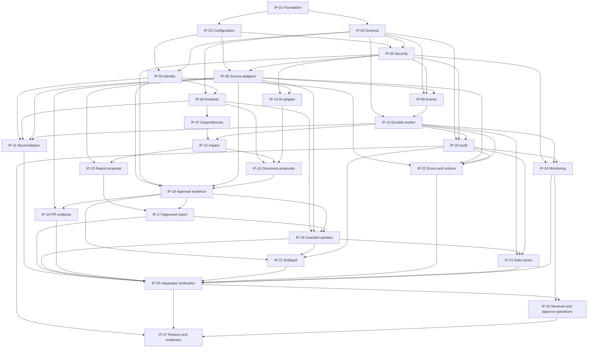

# Implementation Plan: Automated Documentation Sync

**Status:** Proposed Step 4 baseline - effective upon explicit project-owner approval and verified synchronization  
**Phase:** Step 4 - Implementation Planning; no application implementation is included  
**Baseline:** REQ-001 v1.0; approved project-level design review and architecture at commit `8f9955421d9e2891e97dc4817f1d9470703ab00f`  
**Planning owner:** Project Owner / primary technical decision-maker

## 1. Executive summary

Implement a Python modular monolith with an API process, durable background
worker and scheduler, PostgreSQL, and adapters for Jira KAN, the tracked
GitHub repository and Confluence ADS. Changes are detected primarily via
authenticated events, supplemented by reconciliation. Approved dependency
edges determine impact; AI may suggest impacts and draft changes but never
authorize writes. Every application-initiated cross-system write requires
separate, exact-write human approval and verified identity, authority and
versions. Unsupported or unverifiable safety properties disable the affected
write path.

The register below is a proposed execution backlog, not evidence that code,
permissions, integrations or operational objectives have been validated.
Tasks are sized relatively; dates and numeric service targets are not assumed.

## 2. Approved baseline and scope

- [Requirements](requirements.md): REQ-001 v1.0, FR-001-035, NFR-001-010
  and KAN-1 AC1-AC7. Historical open questions in that document are resolved
  only where the final design explicitly resolves them.
- [Architecture](architecture.md), especially section 14, and
  [Design Review](design-review.md), especially section 12. Earlier proposed
  or open statements are historical where superseded by those sections.
  Step 3 was approved and completed at project level; additional organizational
  or evaluator approval is not implied.
- [KAN-1](https://demo-capstone-github-copilot.atlassian.net/browse/KAN-1);
  [ADS Architecture](https://demo-capstone-github-copilot.atlassian.net/wiki/spaces/ADS/pages/164107/Architecture)
  and [ADS Design Review](https://demo-capstone-github-copilot.atlassian.net/wiki/spaces/ADS/pages/65678/Design+Review).
- Repository `ViditTaunk-JayShreeKrishna/automated-documentation-sync`,
  initially tracking `feature/automated-documentation-sync`. Initial scope is
  KAN, this repository and ADS; administrators may change scope through
  authenticated, audited configuration. `main` is not an automatic write target.
- Excluded: application code in Step 4, unrelated projects, a new Node.js
  application runtime, automatic PR creation/push/merge, unapproved writes,
  invented operational targets and unverified claims of integration readiness.
- The architecture contains five source diagrams and matching PNGs:
  [components](component-architecture.png), [data flow](end-to-end-data-flow.png),
  [integration sequence](integration-sequence.png),
  [failure recovery](failure-recovery-flow.png) and
  [deployment](deployment-architecture.png). Historical diagram caveats are
  resolved by the final architecture contract, not by changing the baseline.

## 3. Implementation principles

1. Implement the approved architecture and preserve Jira authority for story
   and acceptance-criteria facts, GitHub authority for versioned files, and
   ADS authority for impact reports and recorded review/design decisions.
   Never infer authority for unregistered artefacts.
2. Jira facts and ADS decision facts retain their authority even when reproduced
   in GitHub-controlled documents. Mirror drift and concurrent changes require
   review, not automatic winner selection.
3. Use human-authored ADS review bootstrap and separately approve exact report,
   document and rollback actions; a published linked report precedes document
   updates. Humans create and review repository PRs.
4. Bind decisions to native identity, authority, proposal revision and digest,
   source and target versions, action and exact diff. Stale or changed content
   requires regeneration and fresh approval; missing evidence fails closed.
5. Commit accepted events and durable work atomically; use idempotent operation
   IDs, leases and outcome checks. Reconcile every 15 minutes by default,
   configurable; allow at most three retries after the initial attempt.
6. Preserve sections, rich content and history; never infer a deletion from an
   ambiguous 404 or automatically create a replacement. Isolate target failures.
7. Workload measurements precede owner-approved numeric operational targets,
   hosting, retention, RTO and RPO. No SLA or production readiness is implied.
8. Every task includes Python tests and evidence; real-site capabilities are
   separately verified, and unsafe or unsupported automation remains disabled.

## 4. Technology stack

Python for services, integration adapters and automated tests; PostgreSQL for
registry, dependencies, durable jobs, review state and protected audit;
Python API and worker/scheduler processes in a modular monolith. Use
provider-independent Python AI interfaces. Exact framework, Python version,
libraries, deployment host, OAuth scopes, notification channel, AI provider
and secret manager are implementation selections, subject to the constraints
and capability validation below; none is represented as already approved or
available. No standalone broker is required initially.

## 5. Workstreams

Foundation and persistence (IP-01-03); identity and security (IP-04-05);
registries (IP-06-07); integrations and events (IP-08-11); impact and AI
(IP-12-15); approval and publication (IP-16-19); recovery, audit and
operations (IP-20-24); integrated verification and operational readiness
(IP-25-27). Owners below are suggested roles, not named assignments.

## 6. Detailed implementation task register

Each task has a task-specific acceptance criterion (AC) below. Its Definition
of Done (DoD) additionally requires the stated deliverable, passing Python
unit tests for its acceptance and failure cases, reviewed code and relevant
documentation, and linked requirement/test evidence. A task involving an
external capability also requires the stated controlled-site evidence, or its
unsafe path remains disabled and the limitation is reported. Requirement
references are abbreviated `FR`, `NFR`; dependencies use task IDs and `-`
means none. Priority C/H/M/L means Critical/High/Medium/Low; size S/M/L means
Small/Medium/Large. Titles are actionable and each row is one proposed Jira
subtask of KAN-1; no effort or assignee is implied.

| ID / title | Scope and component | Requirements | Priority; dependencies; role; size | Deliverable and task-specific AC / DoD evidence |
| --- | --- | --- | --- | --- |
| IP-01 Establish Python service foundation | Create modular API and worker entry points, project tooling and CI test invocation. | NFR-001, 006 | C; -; Python lead; M | Runnable service skeleton and CI; clean environment runs Python tests and starts both processes without Node.js. |
| IP-02 Configure scope and secrets | Typed validated settings for systems, branch, reconciliation and retry; secret-manager/environment integration. | FR-002, 012, 033; NFR-008-010 | C; IP-01; security engineer; M | Configuration guide and checks; invalid scope, missing secrets or unsafe retry limits fail explicitly without exposing values. |
| IP-03 Create durable data schema | Migrations and transaction model for registry, graph, events, jobs, approvals and audit, with uniqueness and version constraints. | FR-001, 004, 010, 013, 021, 029; NFR-001, 004 | C; IP-01; database engineer; L | Reversible migrations and schema; migration and transactional rollback tests prove uniqueness and atomicity on PostgreSQL. |
| IP-04 Enforce roles and owner mappings | Authenticated identities, administrator-managed owner/delegate mappings, role checks and mapping-change audit. | FR-014, 022-023, 028; NFR-006-008 | C; IP-02, IP-03; security engineer; L | Authorization module; unauthorized users and unknown/unverifiable owners cannot approve or perform privileged actions; mapping edits are audited. |
| IP-05 Secure credentials and data handling | Least-privilege OAuth configuration, TLS, encryption at rest, secret exclusion, log redaction and provider data policy checks. | FR-020, 029-030; NFR-006, 008-010 | C; IP-02, IP-03; security engineer; L | Security configuration and negative tests; secrets and sensitive personal data cannot reach logs/reports/AI, and unverified handling blocks use. |
| IP-06 Implement artefact registry | Manual registration and authorized assisted discovery; stable scoped identity, required metadata, owner and mirror mapping. | FR-001-004; NFR-004, 007 | H; IP-03, IP-04; backend engineer; L | Registry APIs and tests; unique UUID and system/scope/external-ID tuple survive confirmed renames/moves; all FR-004 fields persist; unknown ownership blocks dependent actions. |
| IP-07 Implement dependency registry | CRUD, candidate evidence, authorized review/approval and audited edge lifecycle. | FR-013-015; NFR-004, 007 | H; IP-06; backend engineer; M | Persistent graph APIs; only approved edges participate in traversal; unauthorized changes fail and history remains traceable. |
| IP-08 Implement source read adapters | Scoped Jira, GitHub and ADS authenticated reads, pagination, versions, stable IDs, issue links and lifecycle/error semantics. | FR-002-009, 012, 020, 031-032; NFR-008 | C; IP-02, IP-05; integration engineer; L | Adapter contracts and contract tests; each source returns paginated identity/version data or explicit unsupported/inaccessible result; controlled credentials and permissions evidence required. |
| IP-09 Receive and authenticate source events | Jira/GitHub webhooks and supported Confluence Automation request path, sender/replay validation and scoped event normalization. | FR-005-010; NFR-001, 006, 008 | C; IP-03, IP-05, IP-08; integration engineer; L | Receiver and fixtures; invalid/replayed requests rejected, relevant source event types captured, irrelevant metadata/views/reactions filtered; verify actual source trigger/signature capabilities. |
| IP-10 Persist and process event jobs | Atomically accept events and work, deduplicate by source event and target operation IDs, use leases and recover expired claims. | FR-010, 029, 033-035; NFR-001, 004 | C; IP-03, IP-09; backend engineer; L | Durable worker; duplicate and concurrent deliveries process once, crash/restart recovers work, and no acknowledgement precedes durable commit. |
| IP-11 Reconcile missed changes | Scheduled paginated source scans, durable checkpoints and authorized manual trigger. | FR-006-012; NFR-001, 002, 007 | H; IP-04, IP-06, IP-08, IP-10; integration engineer; L | Reconciler; default 15-minute configurable schedule; complete successful scan alone advances checkpoint; missed detectable changes recovered and unavailable history escalated without fabricated recovery. |
| IP-12 Analyze graph impact | Traverse approved direct/transitive edges, track evidence and changed fields, handle cycles and distinguish advisory impacts. | FR-014-016; NFR-004 | H; IP-07, IP-10; backend engineer; L | Impact engine; cyclic graph terminates, reasons and paths are retained, unrelated documents are excluded, AI-only impacts remain advisory. |
| IP-13 Build impact report proposals | Produce complete FR-017 report, source links, deterministic severity and qualitative confidence; prepare ADS Impact Analysis target. | FR-016-018; NFR-004, 010 | H; IP-08, IP-12; backend engineer; M | Report proposal and validation; required fields and links present, classification follows architecture 14.3, incomplete evidence blocks report publication. |
| IP-14 Integrate provider-independent AI | Provider adapter, authorized context selection, input/output screening, response validation and handling policy assessment. | FR-019-020; NFR-006, 009-010 | H; IP-05, IP-08; AI integration engineer; L | Adapter contract and provider assessment; unsafe context, output or unverifiable retention/access terms blocks generation; no provider grants approval. |
| IP-15 Generate versioned update proposals | Assemble per-document section diffs, reason, sources, assumptions, before/after content and immutable revision/digest. | FR-019-021, 024-025; NFR-004-005 | H; IP-06, IP-12, IP-14; backend engineer; L | Stored review-friendly proposals; all FR-021 fields and exact revision/digest match the proposal, and changed context creates a new revision. |
| IP-16 Verify human review evidence | Read human-authored ADS review records and human-created PR evidence; bind native identity, authority, exact action, versions and digest. | FR-022-024, 028-029; NFR-004, 007-008 | C; IP-04, IP-05, IP-08, IP-15; security/integration engineer; L | Review verifier; rejects unauthorized, missing, edited, stale or mismatched evidence and records rejection reason; demonstrate ADS identity/revision and PR base/head/diff semantics on controlled sites. |
| IP-17 Publish approved reports | Separately authorize the exact report write and publish it in ADS Impact Analysis with source links. | FR-017-018, 022-023; NFR-004-006 | C; IP-13, IP-16; integration engineer; M | Report publisher; no write before exact report approval, published report is retrievable and linked, and failure blocks dependent document updates. |
| IP-18 Apply guarded section updates | Enforce authority/mirror mapping, detect drift and use version-guarded unique section writes with rich-content preservation. | FR-023-027, 030, 035; NFR-005-008 | C; IP-06, IP-08, IP-16, IP-17; integration engineer; L | ADS synchronization adapter; unrelated rich content and history preserved; stale versions, ambiguous sections or unsupported atomic guards cause no write and require regeneration/reapproval; full logical replacement needs explicit approval. |
| IP-19 Validate human GitHub PR workflow | Read PR approval, base, head and exact diff; track authoritative committed branch and mirror drift without application PR writes. | FR-022-025; NFR-004-008 | H; IP-08, IP-16; integration engineer; M | PR evidence integration; changed base/head/diff invalidates evidence, unmerged content is not authoritative, and application neither creates, pushes nor merges PRs. |
| IP-20 Record protected audit history | Capture FR-029 evidence, before/after content, dependency and privileged actions, retention settings and integrity controls. | FR-029-030; NFR-004, 006, 009-010 | C; IP-03, IP-05, IP-10; database/security engineer; L | Protected audit store; required evidence survives restart, access is restricted, retention configurable, and inability to retain required evidence blocks the operation and escalates. |
| IP-21 Implement approved rollback | Bind owner approval to current/previous versions and restoration scope, guard restore and retain prior history. | FR-028-030; NFR-004-008 | H; IP-16, IP-18, IP-20; integration engineer; L | Rollback workflow; unauthorized or stale restores perform no write, approved restoration preserves history and records actor, scope and outcome. |
| IP-22 Handle errors and notifications | Classify missing, permission, transient, permanent and ambiguous outcomes; persist owner/admin notifications and delivery escalation. | FR-031-035; NFR-001, 004, 007 | H; IP-04, IP-08, IP-10, IP-20; backend engineer; L | Error/notification workflows; confirmed missing is Not Found without replacement; ambiguous 404 is not deletion; failed notification or absent channel escalates explicitly; eligible targets continue independently. |
| IP-23 Implement safe retries and uncertain writes | Configurable exponential backoff and stable operation correlation, outcome verification before retry of ambiguous writes. | FR-010, 029, 033-035; NFR-001, 004 | C; IP-10, IP-18, IP-20; backend engineer; M | Retry policy; at most initial attempt plus three retries for transient errors, each recorded; unprovable outcome stops and escalates without duplicate write. |
| IP-24 Instrument service operations | Structured redacted logs, metrics, queue/reconciliation monitoring and configurable alerts. | FR-010, 012, 029, 033-034; NFR-002-003, 006, 010 | H; IP-05, IP-10, IP-20; operations engineer; M | Dashboards and alert configuration; metrics include queue age/depth, latency, failures, retries and reconciliation; secrets are absent and delivery failures are visible. |
| IP-25 Verify complete integration scenarios | Python end-to-end, concurrency, recovery, authorization and cross-system contract tests with requirement-linked results. | FR-005-035; NFR-001-010; AC1-AC7 | C; IP-11, IP-17, IP-18, IP-19, IP-21, IP-22, IP-23, IP-24; test lead; L | Test matrix and results; every FR/NFR and AC has observed evidence, including denied writes, missed/duplicate events, conflicts, independent failures and rollback; unsupported capabilities are explicitly blocked. |
| IP-26 Measure workload and approve operations | Define repeatable workload and measure throughput, p50/p95/max latencies, queues, errors and resource use under normal, burst, outage and recovery. | NFR-002-003; DR-013 | H; IP-24, IP-25; operations lead and Project Owner; L | Profile, raw results, hosting/capacity rationale and owner-approved targets, retention, RTO/RPO and alert thresholds; missing approval or failed thresholds blocks production readiness. |
| IP-27 Prove backup, restore and release readiness | Configure retention and backups, restore isolated marker-bearing data, measure recovery and data loss, and prepare runbooks. | FR-029-030; NFR-001, 003-006; DR-013 | H; IP-20, IP-25, IP-26; operations lead; L | Restore evidence, runbook and release readiness decision; restored registry, graph, jobs and audit match markers, observed RTO/RPO meet approved values, and restore is repeated after configuration change. |

## 7. Requirement-to-task traceability

Task acceptance and tests in section 6 are the planned verification evidence;
IP-25 records observed end-to-end results. Listing a task is not a test result.

| Requirement | Implementation tasks |
| --- | --- |
| FR-001 | IP-03, IP-06 |
| FR-002 | IP-02, IP-06, IP-08 |
| FR-003 | IP-06 |
| FR-004 | IP-03, IP-06 |
| FR-005 | IP-08, IP-09 |
| FR-006 | IP-08, IP-09, IP-11 |
| FR-007 | IP-08, IP-09, IP-11 |
| FR-008 | IP-08, IP-09, IP-11 |
| FR-009 | IP-08, IP-09, IP-11 |
| FR-010 | IP-03, IP-09, IP-10, IP-23 |
| FR-011 | IP-11 |
| FR-012 | IP-02, IP-08, IP-11 |
| FR-013 | IP-03, IP-07 |
| FR-014 | IP-04, IP-07, IP-12 |
| FR-015 | IP-07, IP-12 |
| FR-016 | IP-12, IP-13 |
| FR-017 | IP-13, IP-17 |
| FR-018 | IP-13, IP-17 |
| FR-019 | IP-14, IP-15 |
| FR-020 | IP-05, IP-08, IP-14 |
| FR-021 | IP-03, IP-15 |
| FR-022 | IP-04, IP-16, IP-19 |
| FR-023 | IP-04, IP-16, IP-17, IP-18 |
| FR-024 | IP-15, IP-16, IP-18, IP-19 |
| FR-025 | IP-15, IP-18, IP-19 |
| FR-026 | IP-18 |
| FR-027 | IP-18 |
| FR-028 | IP-04, IP-16, IP-21 |
| FR-029 | IP-03, IP-10, IP-16, IP-20, IP-23 |
| FR-030 | IP-20, IP-21, IP-27 |
| FR-031 | IP-08, IP-22 |
| FR-032 | IP-08, IP-22 |
| FR-033 | IP-02, IP-10, IP-22, IP-23 |
| FR-034 | IP-22, IP-24 |
| FR-035 | IP-10, IP-18, IP-22, IP-23 |
| NFR-001 | IP-03, IP-09-11, IP-23, IP-25 |
| NFR-002 | IP-11, IP-24-26 |
| NFR-003 | IP-24-27 |
| NFR-004 | IP-03, IP-06-07, IP-12-13, IP-16, IP-20-21, IP-25 |
| NFR-005 | IP-15, IP-18-19, IP-21, IP-25 |
| NFR-006 | IP-04-05, IP-09, IP-14, IP-16-18, IP-20, IP-24-25 |
| NFR-007 | IP-04, IP-06-07, IP-11, IP-16, IP-18, IP-21-22, IP-25 |
| NFR-008 | IP-02, IP-04-05, IP-08-09, IP-16, IP-18-19, IP-21, IP-25 |
| NFR-009 | IP-02, IP-05, IP-14, IP-20, IP-25 |
| NFR-010 | IP-02, IP-05, IP-13-14, IP-20, IP-24-25 |
| AC1 | IP-08-11, IP-25 |
| AC2 | IP-07, IP-12, IP-25 |
| AC3 | IP-12-13, IP-17, IP-25 |
| AC4 | IP-14-15, IP-25 |
| AC5 | IP-04, IP-16-18, IP-25 |
| AC6 | IP-17-18, IP-25 |
| AC7 | IP-20-23, IP-25 |

Ranges such as `IP-09-11` mean all inclusive task IDs. The individual FRs
remain authoritative; task references do not alter them.

## 8. Task dependency matrix

The register's dependency column is the authoritative direct-edge matrix.
Transitive prerequisites follow from those edges. IP-25 is the integration
gate; IP-26 and IP-27 are later production-readiness gates, not prerequisites
for starting Step 5. No task is implicitly complete.

## 9. Mermaid implementation dependency diagram

Arrows show direct prerequisites. Parallel branches may proceed when their
own prerequisites are complete.

## 10. Phase-by-phase execution sequence

1. Foundation: IP-01, then IP-02 and IP-03 in parallel; IP-04 and IP-05
   follow their prerequisites.
2. Build IP-06/07, IP-08/09/10 and IP-14 in parallel as their dependencies
   permit. Validate external read and event capabilities early; fixtures
   permit development while live credentials are unavailable.
3. Complete IP-11 and IP-12-15; construct report/proposal workflows and
   test registry/graph and detection together.
4. Complete IP-16, then IP-17 and IP-18; IP-19 can proceed after IP-16.
   Complete IP-20 and IP-22/24 in parallel when ready, then IP-21/23.
5. Run IP-25 across all paths. Measure representative workload in IP-26,
   obtain the owner's numeric decisions, then execute IP-27 restore and
   production-readiness gates. Implementation may start before these later
   gates; deployment must not be presented as ready before they pass.

The dependency chain through foundation, event processing, impact, proposals,
approval, report publication, guarded writes, rollback and IP-25 is a
**critical dependency path**. Without duration estimates it is not a
calculated time-critical path; IP-26 and IP-27 extend the release gate.
External access and permission constraints in section 13 apply to controlled
integration work, not necessarily to independent fixture-based work.

## 11. Milestones and deliverables

| Milestone | Included tasks | Prerequisites | Completion criteria and deliverables |
| --- | --- | --- | --- |
| M1 Foundation | IP-01-05 | None | Processes, validated config, migrations, role/security tests and CI pass. |
| M2 Registries | IP-06-07 | M1 | Identity and approved-edge tests, owner mapping and audit evidence available. |
| M3 Detection | IP-08-11 | M1, IP-06 | Adapter contracts, event authentication, durable worker and paginated reconciliation tests pass; live gaps recorded. |
| M4 Impact and proposals | IP-12-15 | M2, IP-08, IP-10 | Cycle-safe impact, complete report and screened AI proposal evidence pass. |
| M5 Approval and synchronization | IP-16-19 | M4, IP-06, IP-08 | Exact approvals, report ordering, guarded ADS writes and human PR evidence verified or affected path disabled. |
| M6 Audit and recovery | IP-20-24 | M1, IP-08, IP-10; IP-18 for IP-21/23 | Audit, rollback, notifications, retries and monitoring verified; unresolved live gaps remain visible. |
| M7 Integrated verification | IP-25 | M2-M6 | Requirement-linked Python and controlled-site results recorded; no unsafe unsupported write enabled. |
| M8 Operational readiness | IP-26-27 | M7 | Owner-approved measured targets, hosting rationale, alerts and restore meeting RTO/RPO evidenced. |

## 12. Testing and verification strategy

Tests use Python; fixtures simulate external systems but do not substitute for
controlled-site proof. Record test ID, requirement, environment, inputs,
expected and observed results, timestamp, version and evidence link; redact
sensitive data. Repeat security tests with unauthorized and revoked identities.

| Component | Unit and integration evidence; failures and security |
| --- | --- |
| Configuration, schema, identity | Validate invalid/missing config and transaction rollback; PostgreSQL migration/uniqueness tests; authorized and unauthorized role/mapping changes, least privilege and secret redaction. |
| Registry and graph | Identity, moves, approved/pending edges, cycles and transitive paths; adapter-backed discovery/pagination; unauthorized mapping or edge edits denied. |
| Events and worker | Signature/replay, filtering, duplicates, loop prevention, concurrent claims and leases; crash between persistence and acknowledgement and worker restart against PostgreSQL; invalid senders rejected. |
| Reconciliation | Fake paginated sources plus controlled live-source capability checks; missed delivery, scan interruption, checkpoint restart, rename, delete, archive, restore, issue-link changes and inaccessible history; authorized manual trigger only. |
| Impact and report | Direct/indirect and unrelated paths, severity/confidence and all FR-017 fields; no fabricated evidence; live ADS report placement, separate report approval and report-before-document ordering. |
| AI and proposals | Malformed outputs, secret and sensitive-data input/output rejection, context authorization, unavailable provider and changed proposal digest; approved provider terms and controlled adapter behavior. |
| Review and PR evidence | Native ADS author/revision and role mapping, human bootstrap, rejection reason, exact proposal/action/diff, revocation and changed source/target; human PR base/head changes and no application PR writes. |
| ADS synchronization | Controlled version-guard race and concurrent edits; unique section selection and rich tables, links, embeds, attachments and page-history preservation; stale changes regenerate and require fresh approval; one failing page does not block eligible others. |
| Retry, notification, audit and rollback | Transient failure and capped exponential retry; ambiguous write verification before retry; concealed 404 versus confirmed missing, permission denial, permanent failure, notification failure, protected complete audit, owner-approved rollback and concurrent restore conflict. |
| Operations | Reproducible normal/burst/outage/recovery workload, latency percentiles and queue/resource metrics; isolated backup restore, marker integrity and measured RTO/RPO against later owner-approved targets; no secret leakage. |

Integration test access must be scoped to approved test artefacts and accounts.
If platform atomic guards, identity, trigger coverage, history or rich-content
preservation cannot be proven, document the gap, fail closed and escalate.
Do not treat best-effort or fixture results as proof of production capability.

## 13. Risk and blocker register

| Item | Type and impact | Resolution and responsible role |
| --- | --- | --- |
| Jira/GitHub/ADS OAuth, scopes and test artefacts not verified for this application | Conditional blocker for live adapter and end-to-end verification, not fixture-based work | Integration owner obtains scoped credentials and confirms read/event/write permissions; security owner reviews least privilege. |
| ADS native review identity/revision, atomic guard, section selection and rich preservation unverified | Conditional blocker for automated ADS writes/rollback | Integration owner performs controlled tests; disable affected path and escalate if unavailable. |
| Webhook signatures, Confluence Automation triggers and source history gaps | Risk; can block coverage for specific event types | Integration owner tests actual source capabilities, paginates scans and escalates irrecoverable history without claiming recovery. |
| Secret management, identity mapping and notification channel not configured | Conditional blocker for privileged operations or escalation | Security and operations owners configure approved controls and verify unauthorized access and delivery failure. |
| AI provider terms and data screening unverified | Conditional blocker for AI generation | AI/security owners verify processing, access and retention terms and negative tests; fail closed if unsafe. |
| Concurrent edits, conflicts or ambiguous write outcomes | Runtime risk of overwrite or duplication | Integration owner proves version guards, reapproval and read-after-uncertain-write correlation; stop if inconclusive. |
| API outages, retry exhaustion or per-page failure | Operational risk | Backend owner records attempts, limits retries, isolates targets and escalates permanent failures. |
| Backup retention, hosting, capacity, availability, RTO and RPO not yet measured or approved | Production-readiness blocker, not planning or fixture implementation blocker | Operations lead executes IP-26-27; Project Owner approves measured targets and hosting before release. |
| Audit retention policy or required evidence incompatible with privacy controls | Conditional blocker for affected operation | Security/Project Owner resolve policy, protect evidence and prevent operation when required evidence cannot be retained. |

## 14. Overall definition of done

- All tasks meet their own deliverables, acceptance criteria and common DoD;
  documentation and traceability remain current.
- Every FR, NFR and original AC has linked executed test evidence and observed
  outcomes; failures and limitations are visible and addressed or the affected
  capability remains disabled.
- Human approval and native authorization are demonstrated separately for
  report, each update and rollback; concurrent edits cannot be silently lost.
- Recovery, audit, secret handling, retry bounds, reconciliation and independent
  target processing are demonstrated on the supported deployment and sources.
- Production readiness additionally requires approved measured operational
  objectives, configured alerts and a successful measured restore. No claim
  of production readiness follows merely from approval of this plan.

## 15. Implementation readiness assessment

The approved design is a planning baseline. Step 5 can proceed once this plan
and its backlog are approved and synchronized; tasks requiring live external
credentials and the production-readiness gates remain conditional as described
above. Explicit approval, the final baseline commit, published page version
and created Jira references must be recorded and independently verified before
Step 4 is marked completed. The approval record, rather than this conditional
statement alone, establishes the plan's project-level status.
